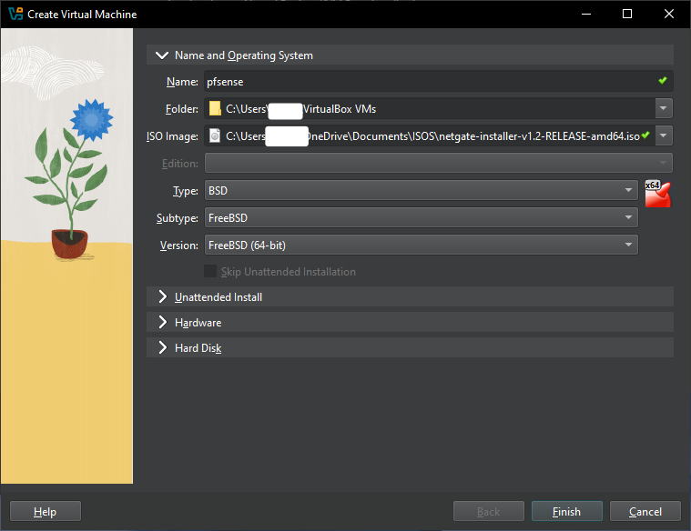
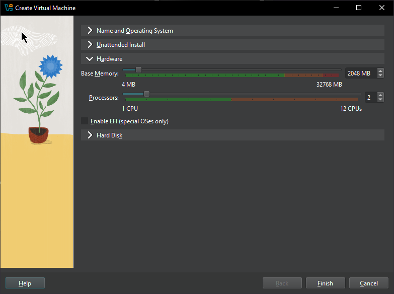
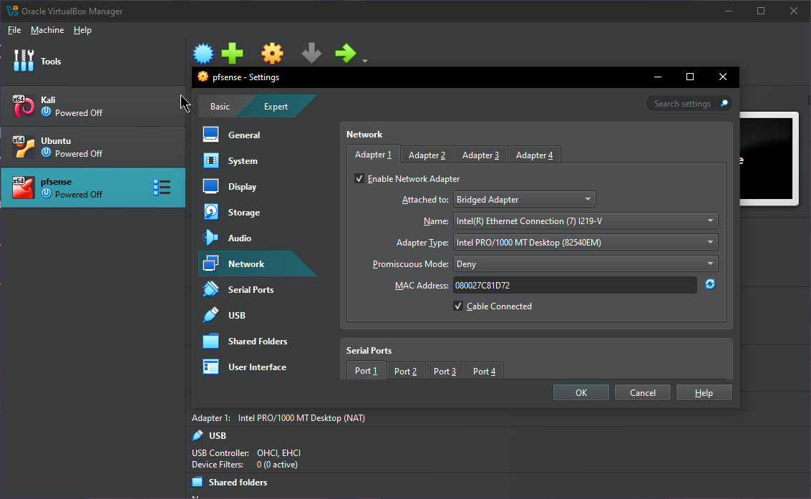
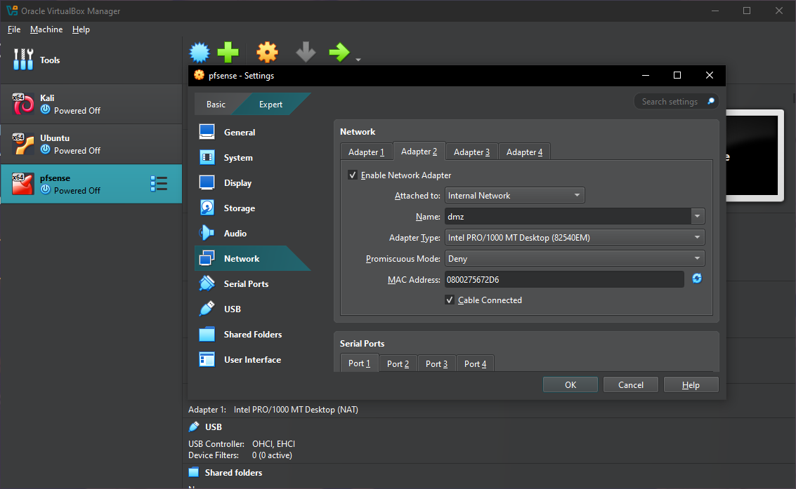
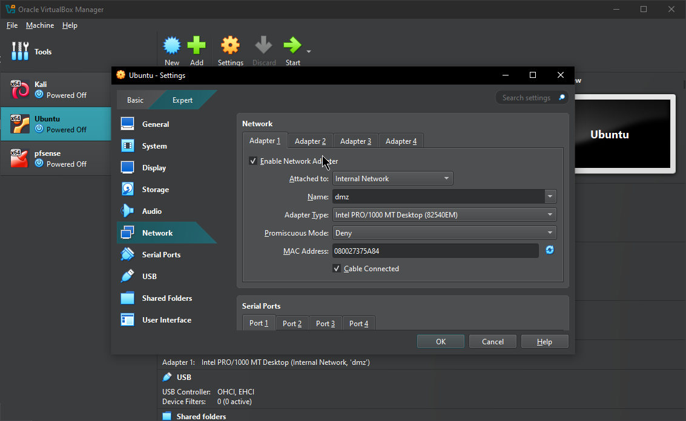
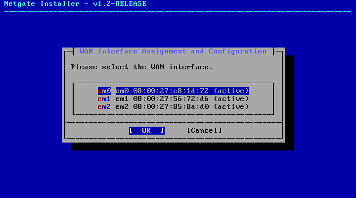
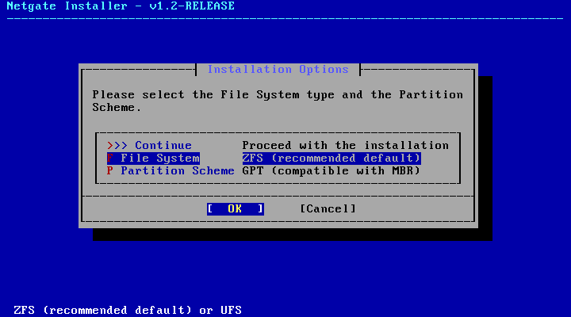
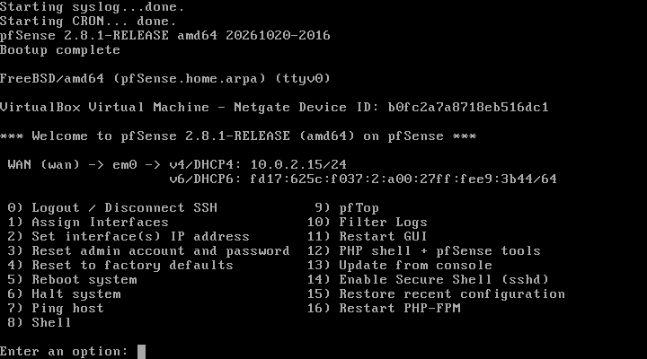
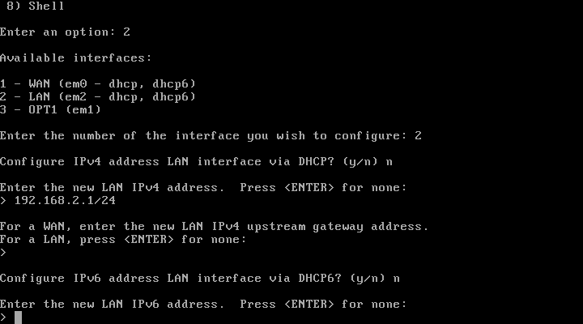
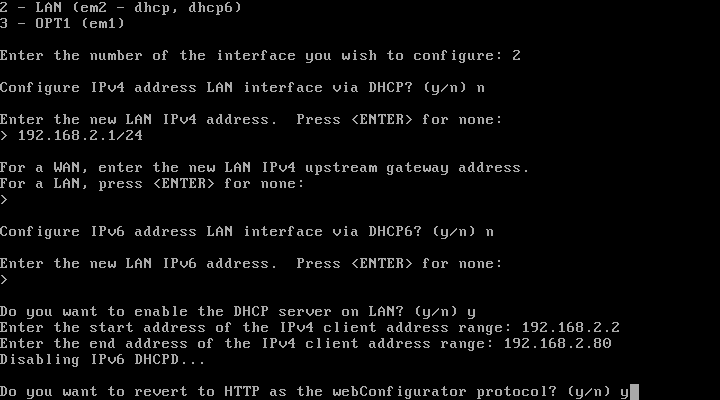

# Instalación.

Después de descargar el archivo ISO del siguiente link [pfsense](https://www.pfsense.org/download/) instalaremos [virtual box](https://www.virtualbox.org/wiki/Downloads) y añadiremos la imagen ISO de la siguiente manera

En la opción de `Hardware` gestionaremos la cantidad de memoria RAM y los CPU, lo mínimo para que funcione son 1 GB de RAM y 1 CPU, pero en este caso usaremos 2 GB de RAM y 2 CPU.

La opción de `Hard Disk` por defecto nos asigna un espacio de almacenamiento de 16 GB pero si tu quieres asignarle más puedes abrir esa opción y aumentar el espacio, pero en este caso lo dejaremos con el almacenamiento por defecto que son 16 GB.

# Preparación de máquinas virtuales.

Además de la instalación de pfsense, procederemos a instalar 2 sistemas operativos diferentes, uno para que actué como la máquina host que es donde accederemos a la configuración del firewall y haremos nuestras configuraciones y otra para que actué como DMZ. En nuestro caso usaremos la distribución de [Ubuntu](https://ubuntu.com/download) como DMZ y [Kali linux](https://www.kali.org/) para entrar al panel de pfsense.

Una vez que hayamos instalado y configurado nuestras maquinas virtuales, nos dirigiremos a la opción `Settings -> Network` en virtual box para configurar las opciones de nuestras interfaces de red, como veras en la imagen primero seleccionamos la opción `Attached to: Bridged Adapter`  como configuración en nuestra maquina virtual pfsense

Después seleccionamos *Adapter 2* y habilitamos el adaptador dando click en el checkbox `Enable Network Adapter` en este caso lo asignamos a la opción `Attached to: Internal Network` y lo nombramos como dmz ya que lo utilizaremos para ese fin, este mismo paso lo haremos de igual manera con el *Adapter 3* solo que lo nombramos LAN

En la siguiente tabla podrás verificar cómo va nuestra configuración y cómo será asignado cada adaptador a las máquinas virtuales que instalamos.

| adaptador en pfsense | Attached to | Nombre | Sistema operativo |
| :---- | :---- | :---- | :---- |
| 1 | Bridged | nombre del adaptador | pfsense |
| 2 | Internal Network | dmz | Ubuntu |
| 3 | Internal Network | LAN | Kali Linux |
| Después al seleccionar nuestras máquinas virtuales Ubuntu y Kali cambiaremos la opción `Attached to:` a `Internal Network` con el mismo nombre que le colocamos en el `Addapter 2` en la máquina pfsense, nota que tanto el nombre y la opción `Attached to:` son idénticas que en la anterior imagen, esto mismo lo haremos también con nuestra máquina Kali. |  |  |  |

# Instalación de pfsense

- Al iniciar nuestra máquina virtual con pfsense le daremos enter a todo hasta llegar a la siguiente opción donde eligiéramos nuestra interfaz `WAN`, usaremos la interfaz `em0`.  
- Nota (en una  
- ventana te pedirá configurar la `LAN`, la puedes configurar desde aquí, si no mas adelante se te explicara como configurarla)

- Después aparecerá otra pestaña que dice `proceed with the installation` le daremos nuevamente enter.  
- Luego nos aparecerá `Active Suscription Validation` aquí daremos enter en `Install CE`  
- Llegaremos hasta una ventana que nos pide opciones de instalacion, aqui seleccionaremos `Continue` y después nuevamente enter

- En la opción de ZFS Configuration nos aparecerá el disco con el nombre ada0 allí es cuando pulsamos espacio y veremos que al lado del nombre del disco aparecerá un asterisco se vera de la siguiente manera, le daremos en `OK`

- Continuamos con la instalación y cuando te pregunte que si quieres reiniciar pfsense antes de darle a reboot retira la ISO en la configuración de virtualbox en `devices --> optical drives` click en reboot, veras que te dara error pero para solucionarlo, cierra la máquina virtual y vuelve a abrirla  
- Al abrir la máquina virtual verás diferentes opciones para configurar nuestro firewall, así como lo podrás ver en la siguiente captura.

# Asignar las interfaces dmz y LAN

Ahora en el menú de opciones de la imagen anterior elegiremos la `opción 1`, para ello escribiremos `1` y le daremos a enter.

## opción 1

con la opción 1 asignaremos las interfaces de red, la terminal te preguntará si quieres habilitar `VLAN` pero por el momento no lo vamos a usar, de acuerdo a la configuración de esta guía, pfsense detectara las interfaces pero con el siguiente nombre de acuerdo a lo que configuramos en las interfaces de red de virtualbox.

De a la imagen debajo, hicimos lo siguiente:

- Elegimos `n` para no seleccionar la `VLAN`  
- Elegimos `em0` para asignarla como la `WAN`  
- Elegimos `em2` para asignarla como la `LAN`  
- Elegimos `em1` para asignarla como Opcional la cual usaremos después como `DMZ`

- Al final, la terminal te mostrará cómo quedarán asignadas las interfaces, si lo hiciste correctamente elige `y` de lo contrario puedes volver a asignarlas si eliges `n`

Para mayor claridad guíate con la siguiente tabla, así deberían quedar nuestras interfaces.

| nombre en pfsense | nombre que le asignamos en el adaptador |
| :---- | :---- |
| em0 | pfsense |
| em1 | dmz |
| em2 | LAN |

## opción 2

Ahora elegiremos la opción 2 y haremos lo siguiente:

- Elegimos la opción `2` y nuevamente `2` para elegir la `LAN`.  
- Nos preguntará si configurar `IPv4` mediante `DHCP` elegimos `n` para poder configurar nuestra red.  
- Asignaremos una IP estática a la interfaz `LAN` por lo tanto lo que tendremos que hacer será revisar en nuestra red que rango de ip está disponible, por ejemplo si tu red usa `192.168.1.1/24` puedes usar la siguiente red `192.168.2.1/24` o también podrías usar `172.16.0.0` o `10.0.0.0`.  
- Después presiona enter, no es necesario configurar el `gateway` o el `broadcast` ya que pfsense lo hará de manera automática.  
- Luego nos pedirá configurar la `IPv6` esta versión de IP no la usaremos en esta guía así que elegimos `n` y presionamos enter.

- Nos preguntara después cuál es la `IP` inicial y final en nuestra red, puedes elegir un rango entre `192.168.2.2` a `192.168.2.254` en este caso elegimos `192.168.2.2` a `192.168.2.80`  
- Al final nos preguntará si queremos que se revierta a una configuración web, usaremos `y` para aceptarlo.

- Ahora podrás ver que la terminal menciona que podremos abrir la configuración web con la ip url `http://192.168.2.1`

Por consiguiente veremos en la nota [2 Accediendo a la interfaz web](2%20Accediendo%20a%20la%20interfaz%20web.md) como entrar y configurar pfsense para comenzar a configurar nuestras reglas en el firewall.