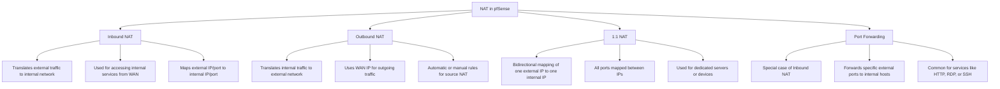

IMPORTANTE: Asegúrate de que la IP publica este disponible en tu IPS, si no puedes preguntarle a quien te esté dando servicio de Internet e incluso pedir una IP publica, sin embargo es más seguro usar vpn o herramientas como zero tier para una conexión a otra red interna, además la siguiente nota [DMZ En router telnor para evitar doble nat](../../OTROS/DMZ%20En%20router%20telnor%20para%20evitar%20doble%20nat.md) te podrá servir para evitar que pfsense y el router trabajen a la par lo que se llama `doble NAT`

IMPORTANTE (2): Consulta las notas [Modo puente en router telmex](CHEAT%20SHEETS%20Y%20TROUBLESHOOTING/Modo%20puente%20en%20router%20telmex.md) y [Router telmex como AP Access Point](CHEAT%20SHEETS%20Y%20TROUBLESHOOTING/Router%20telmex%20como%20AP%20Access%20Point.md)

Network addresses translation traduce una ip pública a una ip privada en nuestra red local.

NAT funciona mediante una política que le dirá a pfsense a donde redireccionar las peticiones desde la WAN hacia el servidor donde queremos redireccionarlos

# Configuración por defecto

La WAN por defecto actuaría como la `outbound NAT` así que todo el tráfico interno se traduce a la IP de la interfaz WAN

El `inbound NAT` está bloqueado por defecto así que si queremos que pase el tráfico en determinados puertos debemos establecer políticas o reglas en el firewall para permitir su ingreso

Si nos dirigimos a la ruta `Firewall --> NAT` Podremos ver estas configuraciones mencionadas

El siguiente diagrama nos muestra cómo funciona cada tipo de NAT en pfsense

&nbsp;

# IPs virtuales

Antes de usar los diferentes tipos de NAT primero cambiaremos la dirección de la NAT y usaremos las IP virtuales

## Cambiando IP privada a pública en WAN

Nos dirigimos primero a la ruta `Interfaces --> WAN` Aquí primero cambiaremos al tipo de ipv4 a Static IPv4 lo cual una vez seleccionada tendremos la siguiente opción disponible

Como vemos ahora estaremos usando una IP pública en la interfaz `WAN`

Cómo cambiamos la IP de la WAN entonces ahora nosotros tendremos que entrar con la IP publica `150.10.20.2`

Ahora si nos dirigimos a la ruta `Firewall --> Virtual IPs`  al añadir una ip virtual

podremos ver primero estas 4 opciones que se muestran en la imagen

Nosotros usaremos `IP Alias` ya que nuestro proveedor de Internet está usando como gateway la ip publica que configuramos por otro lado si estuviéramos usando una IP que no es pública seleccionaremos `other`

`CARP` es usado cuando hay alta disponibilidad o múltiples dispositivos compartiendo una misma dirección IP

El mapeo de estas redes virtuales será igual al que hicimos al mapear las redes privadas, ten en cuenta que serán los disponibles en el rango que asignaste a la IP en este caso solo tenemos 8 disponibles, la siguiente imagen muestra cómo las configuramos

# Source NAT

## Modos de NAT

Ahora nos ubicamos en la ruta `Firewall --> NAT --> Outbound` aquí veremos 4 modos para la aplicación de las reglas

A continuación se explicaran los modos de izquierda a derecha

1. Automatic es la selección por defecto que aplican las reglas automáticas las cuales son las que puedes ver hasta abajo en esta ruta  
2. Hybrid usarás las reglas automáticas y las reglas adicionales que agregues  
3. Manual Outbound usará sólo las reglas adicionales  
4. Disable desactiva NAT para el tráfico de salida

Como podrás notar verás algunas reglas automáticas, sin embargo nosotros trabajaremos con reglas manuales y borraremos estas reglas automáticas por defecto, después procederemos a hacer nuestra primer regla `NAT`

## Configurando regla NAT en LAN

Como te podrás haber dado cuenta no tenemos acceso a Internet después de haber cambiado la interfaz `WAN` a una ip pública estática sin embargo al configurar alguna regla en esa misma opción de Outbound podemos configurar una regla de la siguiente manera

1. Interface \= WAN  
2. Source= Red LAN  
3. Address= WAN Address

Las demás opciones no las movemos y de esta forma tendremos trafico pasando en nuestra red