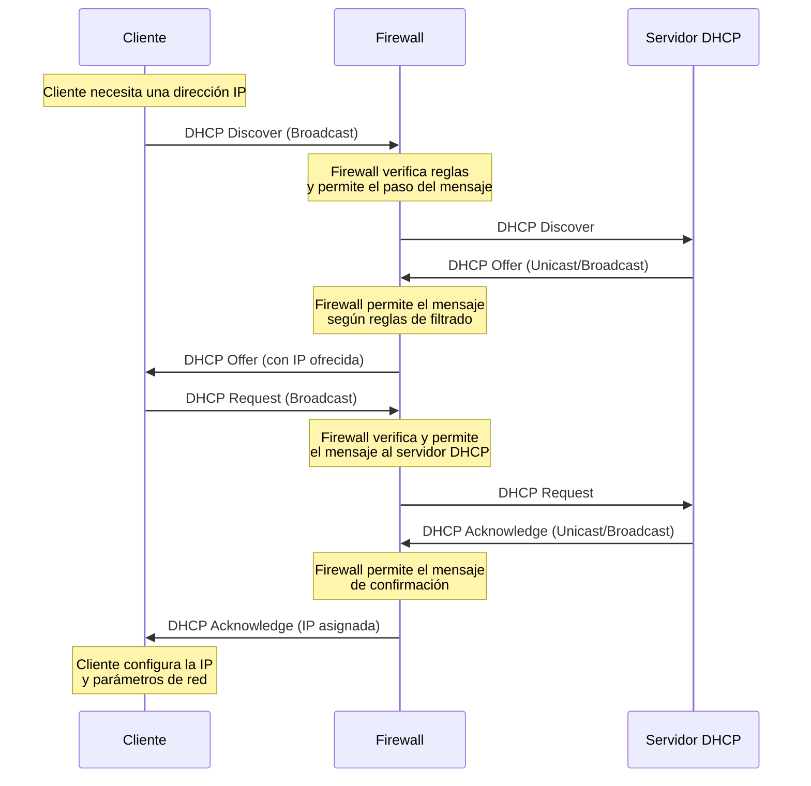
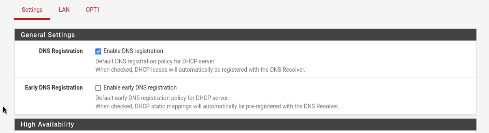
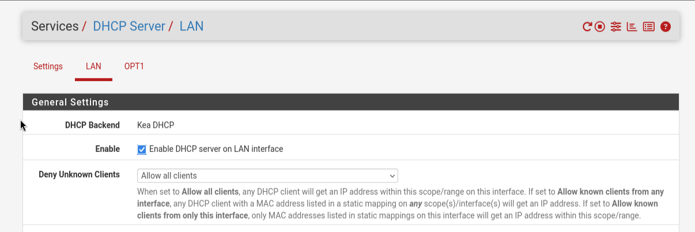
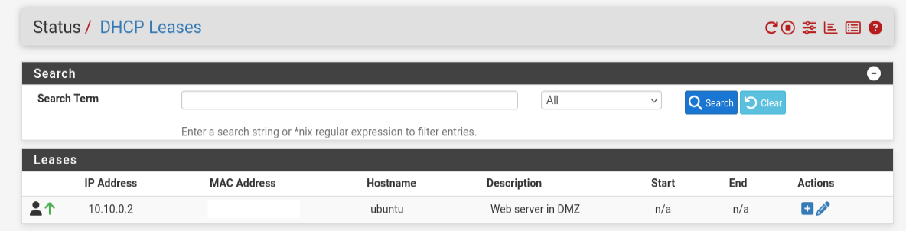

# Asignando IP a nuestra DMZ en la interfaz gráfica

Vamos a `interfaces --> opt1` que recordemos que es la interfaz que habitamos guardado para utilizar en nuestra DMZ, en esta configuración haremos lo siguiente

- En la primera opción damos click en `Enable interface`  
- En IPv4 `Configuration Type` elegimos `Static IPv4` y después las configuraciones que verás en las siguiente capturas.


- No necesitamos el gateway por que esta interfaz está de cara a los clientes  
- No activamos la opción de bloquear tráfico privado porque estaremos usando una ip privada  
- Si activamos el `bloqueo de redes bogon` ya que esta es una buena práctica


Recordemos que en la parte de arriba se mostrará un icono que dice `apply changes` para que los cambios surtan efecto.

# DHCP server

un `DHCP server` es un servidor en nuestra red que asigna automáticamente `IPs` a los dispositivos que se conecten a nuestra red, recordemos que la dirección de nuestra red `LAN` es de `192.168.2.1` a `192.168.2.254`.

Este servidor será configurado tanto en nuestra `LAN` y en nuestro `DMZ`, nos será útil para que tanto la `LAN` y la `DMZ` proporcionen una IP a los clientes

## Diagrama DORA asignación de IP a un cliente

El siguiente diagrama te explicara cómo es que un cliente que se conecte a nuestra red asigna la dirección IP al cliente



&nbsp;

# DHCP pool

En la siguiente imagen nos situamos en `Services --> DHCP Server` y realizaremos las siguientes configuraciones.

- daremos click en `Enable DNS registration`, es la primera opción en `Settings` para habilitar la política por defecto del servidor DNS



- Cambiamos a `LAN` y activamos la opción `Enable DNS registration`



- En `primary address pool` podemos ajustar el rango de IP que asigna nuestro servidor


- El servidor DNS que usaremos será el de cloudflare.


Este fue un ejemplo básico de configuración del dhcp server en la interfaz `LAN` haremos lo mismo para la interfaz `DMZ` o la interfaz `OPT1`

Recuerda que el gateway será la IP de la LAN o de la DMZ depende cual estés configurando.

# Reserva de IP

Ahora nos colocaremos en la siguiente ruta `Status --> DHCP Leases` Aquí podremos ver los equipos que se han conectado mediante el `servidor DHCP`


Abajo de la columna `actions` hay 2 signos \+ si le damos al que tiene el fondo de color blanco nos llevara a la ruta `Status --> DHCP Leases --> DMZ --> Edit Estatic Mapping` aquí es donde podremos configurar nuestra IP estática en el cliente que se conecto mediante la interfaz DMZ el cual se le había asignado una IP automáticamente debido a que activamos nuestro DHCP server

- Nota: El rango de `DHCP pool` que asignamos a nuestra interfaz `DMZ` en este caso es de `10.10.0.10 - 10.10.0.100` así que para el rango de nuestra IP estática le asignaremos una IP de acuerdo al rango de nuestra interfaz `DMZ` que recordemos que es `10.10.0.0/24`. Así que una vez teniendo en cuenta el rango de las IP, asignaremos una IP fuera del pool (rango) del `DHCP server` en la interfaz `DMZ`  
- Asignamos la IP estática `10.10.0.2` nuestra ip en la máquina virtual Ubuntu, se verá de la siguiente manera (recuerda también colocar el servidor de Cloudflare 1.1.1.1, el `gateway` que en este caso es 10.10.0.1, y opcional cambiar el `hostname` y la descripción). Si no recuerdas cómo asignar una IP estática consulta la nota \[\[2 Accediendo a la interfaz web\]\]

Como verás en la siguiente imagen la dirección de nuestra IP estática ha sido agregada.



NOTA: la red `10.10.0.1/24` todavía no tendrá acceso a Internet debido a que debemos configurar la regla en el firewall para permitirle conexión a Internet.

# Reiniciando la IP estática

la IP que configuramos tiene el hostname de 10.10.0.2 sin embargo todavía nos falta reiniciar la IP mediante el comando `dhclient`

el siguiente comando hará un reinicio de nuestra IP y asigna automáticamente la IP mediante el servidor DHCP

```sh
sudo nmcli connection down "connection_name" && sudo nmcli connection up "same_connection_name"
```

Para ver el nombre de tu conexión usa el siguiente comando

```sh
nmcli connection show
```

&nbsp;