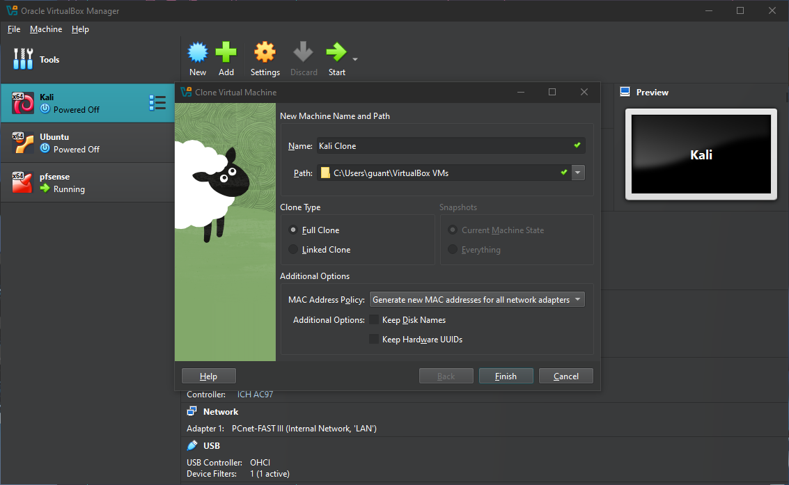
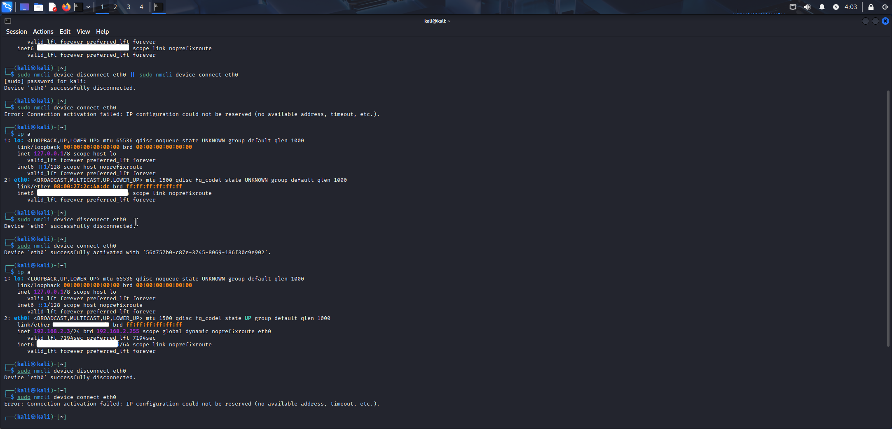

# Repaso

Recapitulemos, hasta entonces nuestra red se ve de la siguiente manera

| adaptador | Attached to | Nombre | Sistema operativo conectado | ip | servidores o funciones activadas | CIDR |
| :---- | :---- | :---- | :---- | :---- | :---- | :---- |
| 1 | bridged | nombre del adaptador | pfsense | `10.0.2.15/24` | DHCP v4 en todas las interfaces | `10.0.2.15/24` |
| 2 | Internal network | DMZ | Ubuntu | `10.10.0.2` IP estática | dhcp pool `10.10.0.10 - 10.10.0.100`<br><br>Reserva de ip en `10.10.0.2` | `10.10.0.1/24` |
| 3 | Internal network | LAN | Kali Linux | `192.168.2.2` ip dinamica | dhcp pool `192.168.2.10 - 192.168.2.100` | `192.168.2.1/24` |

Como sabemos tenemos habilitado el dhcp server en ambas interfaces en el rango que habíamos especificado, sin embargo para evitar que cualquiera entre a la red de Internet mediante wifi o conectándose a un switch o directo al modem, haremos una lista con las `direcciones MAC` de los clientes, como estamos trabajando en virtual box podríamos clonar nuestro cliente conectado a la `LAN` el cual es la máquina Ubuntu, ten en cuenta que al clonar la máquina virtual verifica que se genere una nueva dirección `MAC` y como alternativa, también podríamos usar otra máquina conectada a la interfaz `LAN`

En la siguiente imagen verás como clonamos la virtual machine Ubuntu



# Mapeo de IP

Un mapeado de IP nos ayudará a que solo los clientes que agreguemos a la red puedan conectarse y los que no estén en la lista no puedan conectarse.

Antes de empezar a mapear `IP` necesitamos tener una lista de las direcciones `MAC` , una vez que hayamos recopilado las direcciones, iremos a la ruta `Services --> DHCP Server --> <Elejimos interfaz en este caso LAN> --> Edit Static Mapping` Esta opción ya la habíamos visto en la nota \[\[3 DMZ inicio, DHCP Server y reserva de IP\]\] así que lo que haremos será activar la siguiente opción y al igual que como hicimos en la sección de reserva de `IP` empezaremos a colocar cada dirección que no queremos bloquear


Como vemos, activamos la opción de `deny Unknown Clients` elegimos la opción que solo permite el acceso a la red de cualquier interfaz

Después para configurar las `IP` que queremos que no sean bloqueadas, en la misma pestaña nos dirigiremos hacia abajo de esa pagina y le daremos clic en el recuadro verde en el cual podremos configurar las IP que no queremos que sean bloqueadas


# Prueba 1, Windows

Esta prueba fue creada con una máquina Windows que no está registrada en nuestro mapeo de IPs.

Los siguiente comandos nos servirán para reiniciar nuestra configuración de IP en la máquina.

```cmd
ipconfig /release

ipconfig /renew
```

&nbsp;

Esto retirara la IP que teníamos antes y volverá a pedir al DHCP server una nueva IP sin embargo como esta máquina de pruebas es un cliente que no tenemos en nuestra tabla de IP permitidas tendrá una IP temporal en un rango de 169.254.0.1 \- 169.254.255.254 esta ip se conoce como `APIPA`

# Prueba 2, Linux

La siguiente prueba fue hecha con nuestra máquina que clonamos



A continuación se explicará qué es lo que sucede:

- Al usar `sudo nmcli device disconnect <nombre de la interfaz>` y `sudo nmcli device connect <nombre de la interfaz>` desconectamos la interfaz de la red y la volvemos a conectar para pedir una dirección al servidor DHCP.  
- Después usamos `ip a` para verificar el estado de la red.

Como podrás ver lo intentamos 3 veces este proceso, en la primera ocasión se intentó pedir una dirección IP pero la IP no se encontraba en el mapeo de direcciones, por ello aparece el error `no avalible address, timeout, etc` ademas podrás ver que `ip a` no me entregó ninguna dirección IP y aparece como estado `UNKNOWN`.

Después se repitió el proceso pero la IP la agregamos a nuestra lista de IP, debido a eso ahora `ip a` nos mostrará que la máquina está conectada a la red `192.168.2.3/24` .

Nuevamente se repitió al final el proceso pero con la IP fuera del mapeado, lo que provocó el mismo error que en el primer proceso.

NOTA: Esta configuración es útil en conjunto con la nota \[\[5 ARP\]\] en donde activaremos una opción para que solo las IP estáticas que hayas configurado con esta configuración tengan acceso a Internet.